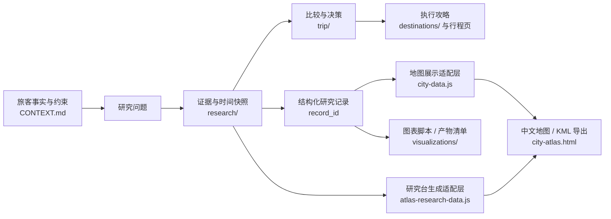

# 西班牙行程资料目录

以本页作为入口。当前资料分为行程决策、分类研究、城市指南和原始研究记录；价格、开放时间、班次和政策均需按标注日期复核。

更新时间：2026-10-11（Asia/Shanghai）

## 当前进度

> 2026-10-11 路线重排：用户已确认国际段统一采用阿联酋航空北京—Barcelona往返结构；西班牙境内改为 Barcelona → Granada → Seville → Barcelona，完全删除 Madrid 的入境定位、返程定位和观光。已同步重写[路线框架](trip/itinerary.md)、[城市间交通](trip/ground-transport.md)、[小时级执行攻略](trip/hourly-guide.md)、[每日现场执行卡](trip/daily-field-cards.md)和预算/住宿/机票口径；动态价格、库存、班次和票规仍需按真实日期复核。

> **天数与航班基准（2026-10-11）：**日期仍按 1/25 亚洲出发、预计 1/26 抵达 Barcelona、2/3 从 Barcelona 离境排演；国际段采用阿联酋航空北京→Dubai→Barcelona往返结构，具体时刻和价格未提供。固定 8 晚为 `Barcelona 3 + Granada 2 + Seville 2 + Barcelona返程定位1`；若最终到达时刻变化，只删除 D1 可选模块，不自动顺延城市。

> **机票研究同步（2026-10-11）：**当前只记录用户选定的 Emirates 北京—Barcelona往返结构，不虚构航班号、当地时刻、价格、北京机场、Dubai停留或行李额度。旧国航/Madrid价格快照保留在历史研究，不再作为当前购票锚点。

> **时长审计（2026-09-27）：**当前固定主计划为 8 晚 `3+2+2+1`，Barcelona 有两个完整日，Granada 和 Seville 各有一个完整主轴日，足够三城核心主线但不足以完成小红书攻略中的全部点位。覆盖不足按“圣家堂、Alhambra、Alcázar、Cathedral、老城/广场”优先级删减，不以暴走或加夜数补点；任何 9/10 晚版本需用户另行确认。

> **转场日执行规则（2026-10-11）：**Barcelona机场到达、Barcelona→Granada、Granada→Seville、Seville→Barcelona都先保证正常抵达、入住/寄存和补给，再视实际时间安排平地短线；Sagrada、Alhambra、Alcázar 等正式预约放在完整日。日落与一月底气候见[研究卡](research/city-weather-sun.md)，雨天、延误或体力不足时整段可删。

> **本轮执行版：**D1 改为 Barcelona 机场入境恢复；D4、D6、D8 分别是 Barcelona→Granada、Granada→Seville、Seville→Barcelona；D8 设为返程整夜缓冲；D5 将 Nasrid 设为硬核心，D7 将 Alcázar 和 Cathedral 设为建筑核心。根目录 `plan.geo.json` 已按新路线重建，网页数据已完成本地同步与校验；机票、住宿、车票和门票仍未购买。

| 领域 | 当前状态 | 主记录 |
|---|---|---|
| 行程 | 已确认 Barcelona → Granada → Seville → Barcelona；往返日期固定、8晚 `3+2+2+1`，D1为Barcelona入境恢复、D4/D6/D8为转场日，D8完成返程定位并住Barcelona；D5/D7保留核心＋可删区域，离境日零观光 | [共享事实](CONTEXT.md)、[路线框架](trip/itinerary.md)、[小时级执行版](trip/hourly-guide.md)、[每日现场执行卡](trip/daily-field-cards.md) |
| 机票 | 用户已选阿联酋航空北京→Dubai→Barcelona往返；具体航班、时间、价格、北京机场、Dubai停留和行李未提供，未出票 | [机票比较](trip/flights.md)、[票价历史快照](research/flights/fare-snapshots.csv) |
| 住宿 | 四段住宿按新日期重排：Barcelona首段3晚、Granada 2晚、Seville 2晚、Barcelona返程定位1晚；1659522/Gamboa/Giralda仍是候选，返程夜单独重查 | [住宿比较](trip/accommodation.md)、[房价快照表](research/accommodation/rate-snapshots.csv) |
| 签证 | 申请地点计划为北京两人、香港一人；香港领区资格待核实 | [签证与入境](trip/visa-and-entry.md) |
| 景点 | Alhambra 官方售票规则已于 2026-10-11 复核；若采用 1/26 北京出发候选版，目标游览日仍为 1/30，动态库存未核实；尚无已购门票记录 | [景点与门票](trip/attractions-and-tickets.md) |
| 小红书研究 | 三城主配额已完整阅读 180/180 篇，另有 2 篇部分阅读；新增 1–2 月冬季专项 18 条城市记录（每城 6 条，不计入主配额）；另完成马德里中转补充 10 篇，并追加 1 条西班牙高铁价格/舒适度交叉验证；2026-09-27 用 Safari 补读圣家堂穿着/拍照合规、5 条超市/伴手礼和 3+3 条签证/行前准备笔记，已分别回写 D2、行李 UI、超市现场卡与签证/行李 checklist；又结合用户既有欧洲经验新增 T-30–T-7 提前采购、到货验收和替代方案时间线；交通、票务、住宿与路线冲突已写回逐篇记录，2027 具体班次/价格/房价/库存仍需定日期后复核；地图研究台现可浏览三城合计 201 条索引 | [研究总索引](research/xhs/README.md)、[签证与行前准备双查](research/xhs/pre-departure-cross-check.md)、[超市伴手礼补充](research/xhs/supermarket-snacks.md)、[马德里中转补充](research/xhs/madrid-transit.md)、[推荐交叉审计](research/xhs/recommendation-cross-check.md) |
| 三城地图 | 在现有中文地图组件上扩展了 16 个本次行程规划点位/路线，并把研究台优化为“资料总览 → 资料工作台 → 详细记录”的工作区：默认先看按用途分组的日程、住宿、餐饮与灵感入口，再进入搜索/分类；当前城市范围会同步更新资料数量与下一步核对事项。每日攻略按“城市 → 日期”组织酒店、景点、交通、餐饮、雨天与晚到删减规则。住宿默认严格排除 CNY 1,500/晚以上和硬条件不合格记录，官方资料与规划候选分层显示 | [地图查看器](research/city-maps/city-atlas.html)、[地图说明](research/city-maps/README.md)、[可编辑计划](plan.geo.json)、[KML](trip.kml)、[日历](gates.ics) |
| 预算与冲突 | 国际机票按用户要求暂不计入当前预算；住宿组合按 Barcelona `1659522`（3晚）+ Granada Gamboa（2晚）+ Seville Giralda（2晚）+ Barcelona返程定位（1晚）重排；真实日期价格、取消政策、床型和三段城际交通仍需复核 | [预算与冲突](trip/budget-and-conflicts.md)、[餐饮策略](trip/dining.md) |

## 资料流

## 行程决策

- [共享事实与待决事项](CONTEXT.md)：跨对话使用的唯一事实总表。
- [每日行程与路线框架](trip/itinerary.md)
- [小时级执行攻略](trip/hourly-guide.md)
- [每日机位·车站·餐厅·超市现场执行卡](trip/daily-field-cards.md)
- [餐厅现场抄作业卡](trip/restaurant-cards.md)
- [人像机位与动作卡](trip/photo-pose-cards.md)
- [国际机票](trip/flights.md)
- [住宿](trip/accommodation.md)
- [签证与入境](trip/visa-and-entry.md)
- [景点与门票](trip/attractions-and-tickets.md)
- [城市间交通](trip/ground-transport.md)
- [预算与冲突审查](trip/budget-and-conflicts.md)
- [餐饮策略](trip/dining.md)
- [旅行当天跟随 UI 原型](trip-guide-ui/)
- [vivo Chrome 手机网页/PWA](trip-guide-ui/site/)，底部“出发前”入口含签证流程、北京/香港材料分组和行李 checklist
- [行前清单数据](trip-guide-ui/public/pre-departure.json)
- [网页托管与安装说明](trip-guide-ui/site/README.md)

## 城市指南

- [Barcelona](destinations/barcelona.md)
- [Granada](destinations/granada.md)
- [Seville](destinations/seville.md)

## 研究资料

- [研究记录规范与数据表](research/README.md)
- [机票特价结构研究](research/flights/fare-patterns.md)
- [可视化产物规范](visualizations/README.md)
- [小红书逐条研究总索引](research/xhs/README.md)，含 Barcelona、Granada、Seville 分页、历史转机补充、[超市伴手礼/零食/面包补充](research/xhs/supermarket-snacks.md)及[签证与行前准备双查](research/xhs/pre-departure-cross-check.md)
- [路线、餐厅与人像点位交叉审计](research/xhs/recommendation-cross-check.md)
- [三城日落与一月底天气参考](research/city-weather-sun.md)
- [参考图素材清单](research/xhs/assets/pose-references/README.md)：人像机位清单；项目另保留落日/晚霞/天际线和食物，排除纯建筑空镜
- [中文交互地图](research/city-maps/city-atlas.html)与[地图接口规范](research/city-maps/README.md)
- [地图研究台生成脚本](research/city-maps/build-atlas-research-data.py)与[生成数据适配层](research/city-maps/atlas-research-data.js)
- [本次可编辑路线计划](plan.geo.json)、[KML](trip.kml)、[行前检查日历](gates.ics)、[插画版视觉摘要（非执行稿）](trip-illustrated.html)
- [旅行工具与平台调研](research/tools-and-sources.md)
- [原始文档归档说明](research/archive/README.md)

## 资料维护规则

- 把稳定偏好和已确认事实记在 CONTEXT.md；价格、库存、班次和开放时间写入对应分类页并标记查询日期。
- 按 research/README.md 分开记录“证据核验状态”和“方案决策状态”；不要把核实程度与是否选择混成一个状态。
- 搜索结果只是线索。机票、住宿和门票的价格、行李、退改规则及可用性应在供应方页面复核；不要把候选写成已预订。
- 小红书只作路线和拍照灵感；营业、票价、交通、安全和拍摄限制需另行核实。圣家堂的着装、器材、食物饮料和静默时段已改用场馆官方规则作为执行依据。
