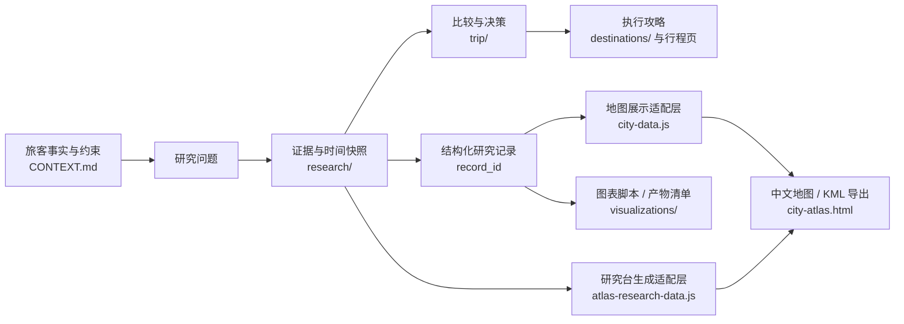

# 西班牙行程资料目录

以本页作为入口。当前资料分为行程决策、分类研究、城市指南和原始研究记录；价格、开放时间、班次和政策均需按标注日期复核。

更新时间：2026-10-29（Asia/Hong_Kong）

## 当前进度（2026-10-28）

> **当前行程：**两名大学生；2026-12-28 13:40 香港出发，经北京，12/29 08:05 抵达巴塞罗那；2027-01-06 11:30 巴塞罗那起飞，经北京，1/7 16:45 抵港。时间由旅客提供，航班号和出票状态待核实。路线为巴塞罗那 → 塞维利亚 → 格拉纳达 → 巴塞罗那，1/5 回巴塞罗那过夜；详见[两人跨年行程](trip/itinerary.md)和[节日及小红书研究](research/holiday-2026-2027.md)。
>
> **返程与三王节：**1/5 白天返回巴塞罗那并住宿，晚上可候选三王巡游；1/6 11:30 从巴塞罗那起飞，1/7 北京 05:30 抵达、13:00 续飞香港。原先 1/6 抵港已由旅客更正为 1/7 16:45。
>
> **旧数据警告：**本地 `plan.geo.json`、KML、行前日历、地图与手机网页已更新；线上版本以发布后核验为准。以下旧三人攻略及旧住宿/交通/门票快照仅供历史参考，不适用于新行程。

| 领域 | 当前状态 | 主记录 |
|---|---|---|
| 行程 | 新城市顺序及人数已确认；1/5 转场班次与巡游待核实 | [共享事实](CONTEXT.md)、[新行程](trip/itinerary.md) |
| 航班与交通 | 城际计划选择火车—巴士—火车，三段均未出票；票价、ISIC 折后、换乘与早餐衔接需复核；国航订单细节待核实 | [城际交通](trip/ground-transport.md)、[查询证据](research/intercity-20261029.md)、[航班](trip/flights.md) |
| 市内交通 | 手机网页每日显示住宿候选与线路接驳；格拉纳达早班、航站楼、节日时刻及 2027 票价需复核 | [市内交通](trip/city-transport.md)、[查询证据](research/city-transport-20261029.md) |
| 节日 | 1/1 两座宫殿关闭；12/31 塞维利亚跨年、1/5 巡游为条件活动 | [证据记录](research/holiday-2026-2027.md) |
| 小红书 | 本次逐篇阅读三城笔记，运营事实另查官方 | [专项记录](research/holiday-2026-2027.md)、[历史索引](research/xhs/README.md) |
| 天气 | 三城气候历史值已区分预报；手机页在日期进入未来 7 天后提供逐日预报和 AEMET 入口 | [天气研究](research/city-weather-sun.md) |
| 冬季拍照 | 已把当地日落估算和三城沿线拍照建议加入当天路线；天气、实地光线与交通均需现场判断 | [日落与天气](research/city-weather-sun.md)、[小红书笔记](research/xhs/winter-photo-20261029.md) |
| 住宿及预算 | 已取消预算上限；三城优先地段与携程双床候选已更新，差评检查范围、房价和返程夜仍需复核；四段均未预订 | [住宿调研](trip/accommodation.md)、[三城住宿区域地图](visualizations/住宿区域-20261029/) |

## 资料流

## 行程决策

- [共享事实与待决事项](CONTEXT.md)：跨对话使用的唯一事实总表。
- [每日行程与路线框架](trip/itinerary.md)
- [小时级执行攻略](trip/hourly-guide.md)
- [每日机位·车站·餐厅·超市现场执行卡](trip/daily-field-cards.md)
- [餐厅现场抄作业卡](trip/restaurant-cards.md)
- [人像机位与动作卡](trip/photo-pose-cards.md)
- [国际机票](trip/flights.md)
- [住宿](trip/accommodation.md)
- [签证与入境](trip/visa-and-entry.md)
- [景点与门票](trip/attractions-and-tickets.md)
- [城市间交通](trip/ground-transport.md)
- [三城市内交通与购票](trip/city-transport.md)
- [预算与冲突审查](trip/budget-and-conflicts.md)
- [餐饮策略](trip/dining.md)
- [旅行当天跟随 UI 原型](trip-guide-ui/)
- [vivo Chrome 手机网页/PWA](trip-guide-ui/site/)，底部“市内交通”提供三城购票速查，“出发前”入口含签证流程和行李 checklist
- [行前清单数据](trip-guide-ui/public/pre-departure.json)
- [网页托管与安装说明](trip-guide-ui/site/README.md)

## 城市指南

- [Barcelona](destinations/barcelona.md)
- [Granada](destinations/granada.md)
- [Seville](destinations/seville.md)

## 研究资料

- [研究记录规范与数据表](research/README.md)
- [机票特价结构研究](research/flights/fare-patterns.md)
- [可视化产物规范](visualizations/README.md)
- [小红书逐条研究总索引](research/xhs/README.md)，含 Barcelona、Granada、Seville 分页、历史转机补充、[超市伴手礼/零食/面包补充](research/xhs/supermarket-snacks.md)及[签证与行前准备双查](research/xhs/pre-departure-cross-check.md)
- [路线、餐厅与人像点位交叉审计](research/xhs/recommendation-cross-check.md)
- [跨年三城气候与逐日预报](research/city-weather-sun.md)
- [参考图素材清单](research/xhs/assets/pose-references/README.md)：人像机位清单；项目另保留落日/晚霞/天际线和食物，排除纯建筑空镜
- [中文交互地图](research/city-maps/city-atlas.html)与[地图接口规范](research/city-maps/README.md)
- [地图研究台生成脚本](research/city-maps/build-atlas-research-data.py)与[生成数据适配层](research/city-maps/atlas-research-data.js)
- [本次可编辑路线计划](plan.geo.json)、[KML](trip.kml)、[行前检查日历](gates.ics)、[旧插画版视觉摘要（历史方案，非执行稿）](trip-illustrated.html)
- [旅行工具与平台调研](research/tools-and-sources.md)
- [原始文档归档说明](research/archive/README.md)

## 资料维护规则

- 把稳定偏好和已确认事实记在 CONTEXT.md；价格、库存、班次和开放时间写入对应分类页并标记查询日期。
- 按 research/README.md 分开记录“证据核验状态”和“方案决策状态”；不要把核实程度与是否选择混成一个状态。
- 搜索结果只是线索。机票、住宿和门票的价格、行李、退改规则及可用性应在供应方页面复核；不要把候选写成已预订。
- 小红书只作路线和拍照灵感；营业、票价、交通、安全和拍摄限制需另行核实。圣家堂的着装、器材、食物饮料和静默时段已改用场馆官方规则作为执行依据。
